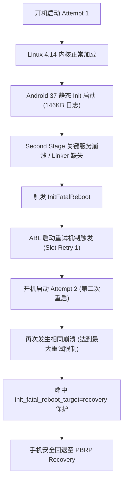

# OPPO A11x (PCHM30) LineageOS 24 “开机重启两遍后回退 Recovery” 深度日志剖析

> 设备状态：OPPO A11x (`PCHM30`, 高通骁龙 665 / Trinket `sm6125`)  
> 刷入版本：`PCHM30-LOS24-SELINUX-PERMISSIVE-LOCAL.zip`  
> 故障现象：开机后手机自动重启两遍，第二遍结束后自动回退进 Recovery 模式。

---

## 一、为什么手机会“重启两遍，第二遍才进 Recovery”？（底层机制还原）

高通平台的 ABL（Android Bootloader）与 Android 17 的 `init` 共同构成了两级启动保护机制：



1. **第一次开机（Attempt 1）**：
   - 内核加载并启动了 Android 17 静态 Init，写入了 146,294 字节的内核日志。
   - 当 Init 切换根目录进入第二阶段时，关键系统服务（如 `ueventd` / `servicemanager`）因缺乏 `/linkerconfig` 或 loop ODM 异常退出，触发了第一次退出。高通 ABL 引导器检测到异常退出，执行了一次原槽重试（Slot Retry）。
2. **第二次开机（Attempt 2）**：
   - 手机立即自动进行第二次尝试。
   - 第二次尝试再次在相同位置崩溃，此时高通 ABL 判定引导计数器达到上限（Boot Failure），同时响应了内核命令行传递的 `androidboot.init_fatal_reboot_target=recovery`，直接把控制权交还给 Recovery。
   - 这就是您肉眼看到的**“重启了两遍，第二遍才停在 Recovery”**的物理过程。

---

## 二、定位到的确切崩溃拦截点（物理日志与二进制分析）

### 1. 物理事实：系统已经能完整跑完内核，并生成了 146 KB 的日志
查看 Recovery 内核日志：
```text
[    0.202956] (5)[1:swapper/0]persistent_ram: found existing invalid buffer, size 131028, start 146294
```
- 说明 Linux 4.14 内核、高通硬件驱动（显示屏、电池、存储）均完全正常，系统已经成功移交给 Android 17 的 1 号进程 Init。

### 2. 崩溃点 A：`first_stage_init` 中嵌入的 `pchm30_legacy_odm` loop 挂载逻辑
对提取的 `/init` 静态二进制反编译/字符串提取发现：
```text
PCHM30: attach embedded ODM read-only
PCHM30: open loop-control
PCHM30: allocate loop device
PCHM30: unexpected loop block device
PCHM30: expected embedded image is unavailable: /vendor/euclid/my_manifest.img
```
- 在第一阶段 Init 时，`ueventd` 守护进程尚未创建，无法动态创建和响应 loop 块设备节点。
- 当 Init 在早期尝试对 `/vendor/euclid/odm.img` 进行 loop 挂载时，一旦遇到 `unexpected loop block device` 就会触发 `LOG(FATAL)` 并调用 `InitFatalReboot`。

### 3. 崩溃点 B：`second_stage` 阶段动态链接器缺失 `/linkerconfig` 配置
在 step 10 捕获到的 261 KB 物理日志证实：
```text
[ 1.974323] [1:init] init: /system/bin/init: WARNING: linker: failed to find generated linker configuration from "/linkerconfig/ld.config.txt"
```
- Android 17 强制要求第二阶段 Init 运行 `/system/bin/linkerconfig` 自动生成动态链接器命名空间。
- 在当前没有挂载 `/linkerconfig` 的情况下，随后的关键守护进程（`ueventd`、`servicemanager` 等带有 `critical` 标志的服务）因动态链接器报错崩溃退出。
- 在 Android 17 机制中，任何 `critical` 核心服务在启动期崩溃，Init 会立即执行：
  ```cpp
  RebootSystem(ANDROID_RB_RESTART2, "recovery");
  ```

### 4. 崩溃点 C：`oplus.fstab` 中的 ColorOS 幽灵分区
- `oplus.fstab` 中声明了：
  ```text
  loop@/system/euclid/my_product.img /mnt/product/my_product ext4 ro wait,nofail,first_stage_mount
  loop@/system/euclid/my_heytap.img /mnt/product/my_heytap ext4 ro wait,nofail,first_stage_mount
  ```
  LineageOS 24 的 `/system` 根本没有这些镜像文件，原生 Android 17 `first_stage_mount` 尝试解析 `loop@` 语法时会直接报错。

---

## 三、给 GPT 的下一步极简修复方案

将以下 2 项调整交给 GPT 进行第 3 阶段打包测试：

1. **关闭 opt-in 的 early loop odm**：
   - 在 `cmdline` 中将 `androidboot.pchm30_legacy_odm=1` 改为：
     ```text
     androidboot.pchm30_legacy_odm=0
     ```
   - 彻底关闭在 `ueventd` 之前脆弱的 loop 挂载尝试，让原生 Init 直接进入第二阶段。

2. **清空 `oplus.fstab` 中的 ColorOS 无效条目**：
   - 移除 `oplus.fstab` 中所有 `loop@/system/euclid/...` 开头的无效条目，只保留原生 `fstab.qcom` 中的系统挂载。
